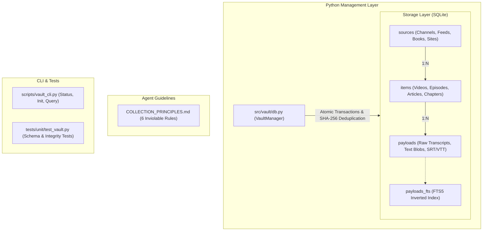

# Data Brochure: Raw Linguistic Vault

High-performance, immutable multi-register linguistic storage layer and collection directives.

## Architecture



## Features

- **Relational Schema**: Clean 3-tier hierarchy (`sources` $\rightarrow$ `items` $\rightarrow$ `payloads`) with cascade deletes and foreign key constraints.
- **Concurrency & Speed**: SQLite Write-Ahead Logging (`WAL` mode) with synchronous normal and 5000ms busy timeout for concurrent multi-agent ingestion.
- **Cryptographic Deduplication**: SHA-256 payload identification ensures zero duplicate transcript storage.
- **Full-Text Search (FTS5)**: Integrated inverted index with automatic triggers for instant phrase search across multilingual text.
- **Strict Directives**: Binding rules of engagement documented in [`COLLECTION_PRINCIPLES.md`](COLLECTION_PRINCIPLES.md).

## Quick Start

### 1. Initialize the Vault Database
```bash
python scripts/vault_cli.py init --db-path data/vault/raw_vault.db
```

### 2. View Vault Statistics
```bash
python scripts/vault_cli.py stats --db-path data/vault/raw_vault.db
```

### 3. Full-Text Search
```bash
python scripts/vault_cli.py search "keyword or phrase" --db-path data/vault/raw_vault.db
```

### 4. Running the Tests
```bash
uv run pytest tests/unit/test_vault.py -v
```
